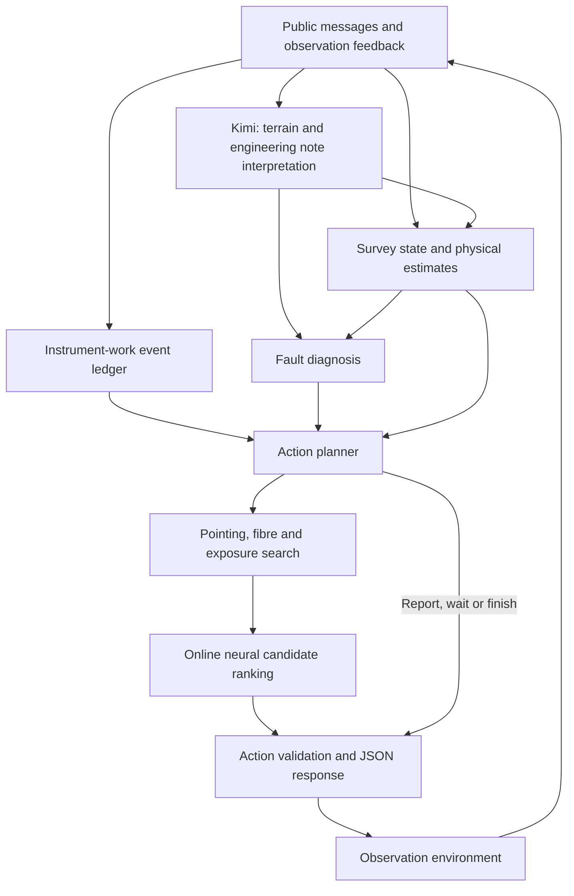

# Event-driven neural observer

An autonomous telescope scheduler combining numerical observation planning, online neural learning, and event-driven instrument operations. It reads public survey messages and returns one JSON action per decision.

## Architecture



### Decision loop

1. **Update state.** Track target completion, visibility, weather notices, instrument response, terrain and active requests from delivered feedback.
2. **Handle events.** Parse explicit instrument-work notices into a dated ledger. Due events can trigger a report; upcoming events shorten the planning horizon so exposures are recomputed around them. Unexplained throughput losses use separate fault diagnostics.
3. **Search observations.** Evaluate candidate pointings, fibre assignments, exposure lengths and observing programs. Balance expected improvement, required targets and time-limited requests against observation time. Adjust search effort to the remaining CPU budget.
4. **Learn and select.** A small online neural network learns the residual between predicted and observed target returns, then adjusts candidate rankings. It trains during the run and resets after a confirmed instrument repair.
5. **Validate and execute.** Emit an `observe`, `report`, `wait` or `finish` action. Feed the next result back into the state and learning modules.

### Kimi's role

Kimi interprets relevant terrain and engineering notes into structured claims. Those claims feed the terrain model and engineering diagnostics. Calls are triggered by relevant messages and bounded by a request budget; a run may make no calls when no eligible notes arrive.

The active planner uses numerical search and neural ranking for observation selection. The general expert-policy review code is not connected to the active decision path in this version.

## Code layout

| Module | Responsibility |
| --- | --- |
| `agent.py`, `protocol.py`, `validation.py` | JSON-Lines interface and action validation |
| `planner.py`, `calendar_governor.py` | Decision orchestration and compute allocation |
| `state.py`, `geometry.py`, `scoring.py` | Survey state and observation model |
| `search.py`, `optimizer.py` | Pointing, fibre and exposure optimization |
| `online_neural.py`, `online_outcome.py` | Online residual learning and candidate ranking |
| `scheduled_operations.py`, `vendor_notes_schedule.py` | Work-notice parsing, event timing and report feedback |
| `station_notes.py`, `engineering_notes.py`, `llm_client.py` | Kimi integration and structured note interpretation |
| `report_budget.py`, `collapse_recovery.py`, `bonus_certificate.py` | Report arbitration and fault diagnostics |

Modules are under `agent_core/`.

## Running

The platform entry point and dependency installation are defined in `observer.project.json`. For local protocol execution:

```bash
python -m pip install -r requirements.txt
python -u agent.py
```

Provide JSON-Lines requests on stdin. Responses go to stdout and logs to stderr.

Configure Kimi through the platform's secret settings or environment:

- `OPENAI_API_KEY`: your secret key
- `OPENAI_BASE_URL`: `https://api.kimi.com/coding/v1`
- `OPENAI_MODEL`: `kimi-for-coding`

Set `AGENT_LLM_ENABLED=0` to disable model calls.

## Attribution

The unchanged schedule parser comes from [Argelander](https://github.com/hou-physics/gosim2026-agentic-observer-argelander), commit `a98cb68324effbe11bc0d732ea519dafc4285edd`, under the MIT license. See `LICENSE.argelander`. Event arbitration and planner integration are implemented in this project.
